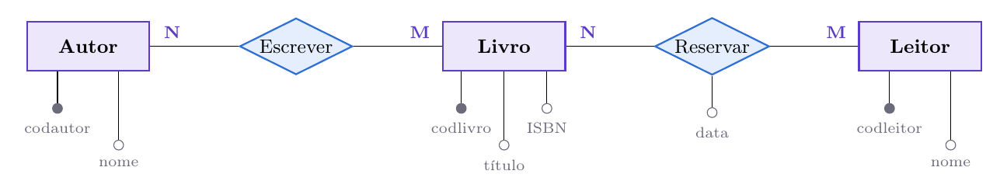
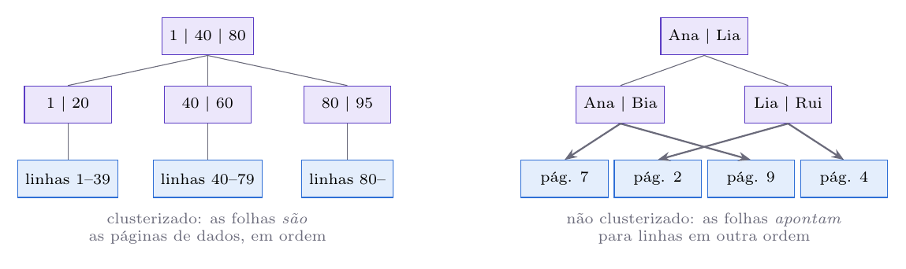
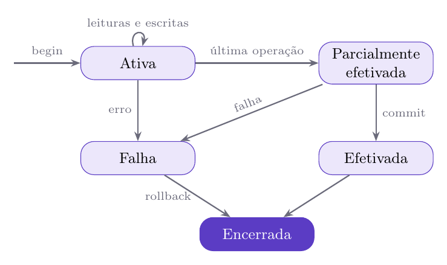

<h1 align="center">Caderno da Especialização</h1>

<p align="center">
  Especialização em Engenharia e Administração de Sistemas de Banco de Dados<br>
  Faculdade de Tecnologia da Unicamp
</p>

<p align="center">
  <a href="https://www.unicamp.br/"></a>
  &nbsp;&nbsp;&nbsp;&nbsp;
  <a href="https://www.extecamp.unicamp.br/"></a>
</p>

Resumos das disciplinas da especialização, escritos em LaTeX e sincronizados com o Overleaf. Cada capítulo junta o conteúdo da aula com complementos da bibliografia indicada e da documentação oficial, sempre com a fonte citada na margem. Cada disciplina termina com as avaliações resolvidas e um roteiro de estudo com perguntas em três níveis (rever, aplicar e aprofundar), sem as respostas.

## Prévia

Os diagramas são desenhados em TikZ, com exemplos próprios.

<p align="center">
  <br>
  <em>ME-R de uma biblioteca (CET 615, capítulo 1)</em>
</p>

<p align="center">
  <br>
  <em>Índices clusterizado e não clusterizado (capítulo 3)</em>
</p>

<p align="center">
  <br>
  <em>Estados de uma transação (capítulo 4)</em>
</p>

## Disciplinas

| Código | Disciplina | Situação |
| --- | --- | --- |
| CET 615 | Fundamentos de Sistemas de Banco de Dados | concluída |

As demais disciplinas estão listadas no prefácio e entram conforme o curso avança.

## Estrutura

```
main.tex                 documento principal (preâmbulo, capa, ordem das partes)
main.bib                 referências
chapters/cover.tex       capa e verso da capa (sobre as anotações e colofão)
chapters/preface.tex     prefácio com as disciplinas do curso
chapters/cet615/         um arquivo por capítulo da CET 615, incluindo avaliações e roteiro
images/                  logos e imagens usadas no texto
images/capa-arte.py      gera images/capa-arte.pdf, a arte de fundo da capa
```

Os arquivos de exemplo do template continuam em `chapters/`, mas não entram no PDF.

## Como compilar

No Overleaf, basta abrir o projeto: ele compila sozinho.

Localmente, com uma distribuição TeX completa (TeX Live, por exemplo):

```
latexmk -pdf main.tex
```

O `latexmk` roda o `pdflatex`, o `biber` e o `makeindex` quantas vezes for preciso.

A arte da capa já está gerada em `images/capa-arte.pdf`. Para gerar de novo (a semente é fixa, então o resultado é o mesmo):

```
uv run --no-project --with matplotlib --with numpy python images/capa-arte.py images/capa-arte.pdf
```

## Sobre o conteúdo

Os resumos foram escritos com palavras próprias a partir das aulas, dos slides e da bibliografia. Os slides, scripts e listas de exercícios pertencem aos professores de cada disciplina e não estão neste repositório.

O layout usa a classe [kaobook](https://github.com/fmarotta/kaobook), distribuída sob a LaTeX Project Public License (ver `MANIFEST.md`).
